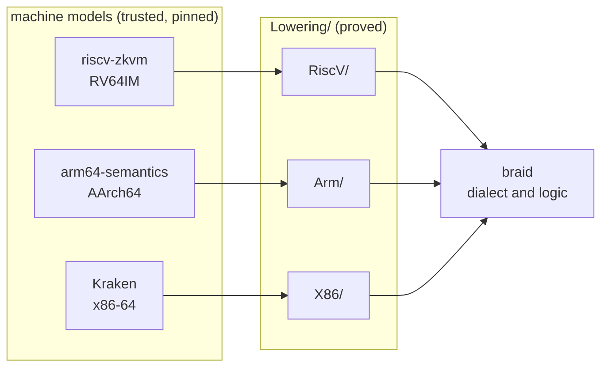

# The lowerings

Each instruction set is lowered into the `braid` dialect, one block for each instruction, and
each lowering is proved sound against the model of its instruction set. This directory is the
verified core between the three models and the logic.



## The shape of a lowering

Every instruction set has the same four things, with the same names
([`STYLE.md`](../STYLE.md)).

| Name | What it is |
| --- | --- |
| `lower` | the block of one instruction, at its address |
| `Rel` | a machine state and a `braid` state that describe the same machine |
| `lower_sound` | if the block runs without fault and establishes a postcondition, the machine takes its step into a related state that satisfies it |
| `triple_sound`, `machine_sound` | a triple of the logic about lowered code, as a statement about the machine |

A block reads and writes the machine through the operations of the dialect only: `get` and
`set` for registers, `getf` and `setf` for flags, `load` and `store` for memory. Whatever the
instruction set does that the dialect has no word for is spelled out in those operations: a
sub-register is a mask and a shift, a flag is an expression in the operands, an alignment rule
is a `guard`. An instruction outside the lowering is a `trap`, whose precondition is `False`:
a proof cannot pass through it, so leaving an instruction out never makes a theorem wrong.

Soundness goes one way. A run of the lowered code is a run of the machine; where a lowering is
stricter than its model, a proof gets stuck and does not go wrong
([`docs/Trust.md`](../docs/Trust.md)).

## RISC-V (`RiscV/`)

The model is riscv-zkvm's `Rv64`, which is tied to the Sail RISC-V model.

| File | What is in it |
| --- | --- |
| `Lower.lean` | `lower`, `lowerCode` |
| `Mem.lean` | the model's doubleword memory, byte by byte |
| `Sound.lean` | `Rel`, `lower_sound`, `lowerCode_sound` |
| `Logic.lean` | register names, `triple_sound`, `machine_sound` |
| `Leak.lean` | trusted: what each instruction reveals, the events of `ECALL`, `RunL` |
| `LeakSound.lean` | the lowering preserves traces, `lowerCode_soundL` |
| `Env.lean` | `ECALL` lowered as the environment's write and exit, `lowerEnv` |
| `Program.lean` | `Loaded`, `program_soundT`: a traced triple about an image, of every machine that has it loaded |
| `Safety.lean` | a run that halts passes through every reachable state; `RunL.safe` |

Covered: every instruction the model has (RV64IM as far as the model goes), with `ECALL`,
`EBREAK` and the accelerator instructions lowered to `trap`. The top theorem turns
`Braid.Eventually` into a number of steps of the model's `stepN`.

## AArch64 (`Arm/`)

The model is the trusted package of arm64-semantics. It fetches and decodes bytes itself, so
the lowering is stated on instruction words.

| File | What is in it |
| --- | --- |
| `Lower.lean` | `lower`, `lowerProgram` |
| `Mem.lean` | permissions and bytes of the model's memory |
| `Rel.lean` | `Rel`, and what each piece of a block does to related states |
| `Simd.lean` | the vector instructions, lowered soundly |
| `Sha.lean` | the SHA-256 instructions, lowered soundly; the words each writes |
| `Sound.lean` | the integer instructions, `lower_sound`, `lowerProgram_sound` |
| `Logic.lean` | register and flag names, `lowerWords`, `triple_sound`, `machine_sound` |
| `Leak.lean` | trusted: what each instruction reveals, the events of `SVC #0`, `RunL` |
| `LeakSound.lean` | the lowering preserves traces, `lowerProgram_soundL` |
| `Env.lean` | `SVC #0` lowered as the environment's write and exit, `lowerEnv`; runs that keep what they do not store to, `RunS` |
| `ReadOnly.lean` | sections with contents as read-only assertions, zeroed ones as writable |
| `Program.lean` | `Loaded`, `program_soundT` |
| `Safety.lean` | no store outside a range, of every reachable state; `RunS.safe` |

How the machine appears in `braid`:

- `X0` to `X30` are registers 0 to 30, and `SP` is register 31. `N`, `Z`, `C`, `V` are flags
  0 to 3.
- A vector register is two registers: `V k` has its bits 0 to 63 in register `64 + 2 * k`
  (`Regs.vlo k`, printed `v<k>.lo`) and its bits 64 to 127 in register `65 + 2 * k`
  (`Regs.vhi k`, printed `v<k>.hi`). A vector instruction works on one half after the other,
  and an operation on lanes is `BinOp.lanes` on each half.
- A shift of lanes by a constant is the shift of each half by that constant and an `and` with
  a constant mask, which clears the bits that crossed from one lane into the next. `USRA`
  then adds the lanes with `BinOp.lanes`, and `SRI` and `SLI` keep the bits of the destination
  outside the mask. A reversal of elements exchanges neighbouring groups of bits in the same
  way, the smallest groups first: `REV32` of 16-bit lanes is one exchange of groups of 16
  bits. `EXT` takes each word of its result from one word of its operands, or from the end
  of one and the start of the next with two shifts and an `or`.
- The SHA-256 instructions are operations on words. `SHA256SU0` and `SHA256SU1` mix the
  32-bit lanes of a word with shifts and masks and add lanes with `BinOp.lanes`
  (`su0Lo`, `su0Hi`, `su1Lo`, `su1Hi`). `SHA256H` and `SHA256H2` take the eight working words
  out of the lanes, each into the low half of a value, and do four rounds (`Work.step`,
  `hashWork`): a rotation of `x` below `2 ^ 32` is one shift of `x ||| x <<< 32`, a sum
  carries into the high half, and only the new first and fifth working word of a round are
  masked. The result words are `sha256hLo`, `sha256hHi`, `sha256h2Lo` and `sha256h2Hi`.
- The model runs one thread, so a load-acquire, a store-release and an atomic
  read-modify-write are a load, a store, and the two with the operation between, each with
  a `guard` that the address is aligned.

Covered: the integer core, which is data processing with immediates and registers, shifted
and extended operands, moves, bit fields, conditional selects and compares, multiplication
and division, `REV`, `RBIT`, `CLZ` and `CLS`, loads and stores in every addressing mode,
pairs, and branches; `LDAR`, `STLR`, `LDAPR`, `LDXR`, and the atomic read-modify-writes
(`LDADD`, `LDCLR`, `LDEOR`, `LDSET`, the maxima and minima, `SWP`). Of the vector
instructions:

| Instructions | Covered | Left as `trap` |
| --- | --- | --- |
| `ldrSimd`, `strSimd`, `ldpSimd`, `stpSimd`, `ldnpSimd`, `stnpSimd` | sizes `B`, `H`, `S`, `D`, `Q`, every addressing mode | `ldrSimdLit`, `LD1` to `LD4`, `ST1` to `ST4`, `LD1R` |
| `fmovGprVec` | `FMOV` between `W`, `X` and `S`, `D`, `V.D[1]` | conversions between integers and floating point |
| `fpDataProc1`, `fpImm`, `fpCondSelect` | `FMOV` of a register or a constant, `FCSEL` (`S` and `D`) | arithmetic, conversions, half precision |
| `simdThreeSame` | `AND`, `BIC`, `ORR`, `ORN`, `EOR`, `BSL`, `ADD` and `SUB` of lanes of 8 to 64 bits | `BIT`, `BIF`, comparisons, shifts, `MUL`, `ADDP`, saturating and floating point |
| `simdImmShift` | `MOVI` of a byte, a byte mask, or a shifted 32- or 16-bit constant; `SHL`, `USHR`, `USRA`, `SRI` and `SLI` of lanes of 8 to 64 bits, in 64 or 128 bits | `MVNI`, `ORR`, `BIC`, `FMOV` constants, the signed, rounding, saturating, narrowing and widening shifts |
| `simdInsDup` | `DUP` from a general register and from a lane, `INS` from a general register, `UMOV`, `SMOV` | `INS` from a lane |
| `simdTwoRegMisc`, `simdAddpScalar` | `NOT`, `REV16`, `REV32` of bytes and of 16 bits, `REV64` of bytes, of 16 and of 32 bits, scalar `ADDP` | the rest of `simdTwoRegMisc` |
| `simdExt` | `EXT` at every position, in 64 or 128 bits | |
| `cryptoSha2Reg`, `cryptoSha3Reg` | `SHA256SU0`, `SHA256H`, `SHA256H2`, `SHA256SU1` | the SHA-1 instructions |

Not yet covered: compare-and-swap, store-exclusives and the exclusive pairs, `LDAPUR` and
`STLUR`, CRC, system registers and calls, floating-point arithmetic and comparisons,
`simdAcrossLanes`, `simdPermute`, `simdTbl`, `simdDupScalar`, `simdPmull`,
`simdThreeDiff`, and AES, SHA-1, SHA-512 and SHA-3. On a whole Go binary, 97% of 118,148 instructions lower to
something other than `trap`. Of the 1,105 that trap, the largest groups are `STXR` (369), AES
(191) and `CAS` (119). Before the vector instructions, `LDAR`, `STLR`, `CLZ` and `RBIT` were
added, 3,388 trapped.

## x86-64 (`X86/`)

The model is Kraken's x64 semantics. Its programs are assembly: instructions with sizes, laid
out from a start address. Its semantics is a set of outcomes all of which must satisfy the
postcondition, the same style as the dialect's, so the top theorem carries `Braid.Eventually`
to the model's own `Eventually` with no step count in between.

| File | What is in it |
| --- | --- |
| `Lower.lean` | `lower`, `lowerProgram`, and the pieces a block is made of |
| `Mem.lean` | the model's byte map as `braid` memory: loads and stores |
| `Flags.lean` | the model's integer-valued flag conditions, as overflow predicates |
| `Rel.lean` | `Rel`, and what each piece of a block does to related states |
| `Ops.lean`, `Shift.lean`, `ShiftCl.lean`, `DShift.lean`, `Rotate.lean`, `Carry.lean`, `Mul.lean` | each instruction, lowered soundly |
| `Vec.lean` | a vector as its 64-bit words: registers, wide loads and stores, packed addition, lanes of the model's `ofLanes`, rotations, shifts, truth tables and shuffles of lanes |
| `Avx.lean` | each vector instruction, lowered soundly |
| `Sound.lean` | control flow, `lower_sound`, `lowerProgram_sound` |
| `Layout.lean` | the lines of a binary as an executable of the model |
| `Logic.lean` | register and flag names, `triple_sound`, `machine_sound` |
| `Leak.lean`, `LeakOps.lean`, `LeakAvx.lean` | trusted: what each instruction reveals, `RunL` |
| `LeakSound.lean` | the lowering preserves traces, `lowerProgram_soundL` |
| `Program.lean` | `Loaded`, `program_soundT` |
| `Safety.lean` | `Next`, `Reachable`; no store outside a range, of every reachable state; `program_safeT` |

How the machine appears in `braid`:

- `rax` to `r15` are registers 0 to 15. `cf`, `pf`, `af`, `zf`, `sf`, `of` are flags 0 to 5,
  and the direction flag is flag 6.
- A 512-bit vector register is eight registers, a word in each: word `j` of `zmm k`, counted
  from the low end, is register `32 + 8 * k + j`, printed `zmm<k>.<j>` and named
  `Regs.zmm k j`. `xmm k` is the low two words and `ymm k` the low four. `Rel` says each of
  the 256 registers holds its word of the model's register.
- A vector in memory is loaded and stored a word at a time, low word first. A write of a
  vector register by a VEX or EVEX instruction clears the words above its width, and one by
  a legacy SSE instruction keeps them, as in the model. A move that must be aligned (`movaps`,
  `movdqa`, `vmovdqa32`, and the source of `paddd`, `pshufd`, `pblendw`, `palignr`,
  `pshufb` and the SHA-256 instructions) has a `guard` on its address.
- A value narrower than 64 bits is held zero-extended. Reading `eax` is a `get` and a `zext`;
  writing it clears the upper half, and writing `ax` or `al` keeps the other bits.
- A flag the model leaves undefined is a `havoc`. So is the auxiliary carry flag, always: no
  condition code reads it, and leaving it unknown keeps every arithmetic block shorter.
- `push`, `pop`, `call` and `ret` are the stack-pointer arithmetic and the load or store they
  stand for. A return address is a word in memory like any other.

Covered, at every operand width unless said otherwise: `mov`, `movzx`, `movsx`, `lea`,
`push`, `pop`, `setcc`, `cmovcc`, `add`, `adc`, `sub`, `sbb`, `cmp`, `inc`, `dec`, `neg`,
`not`, `test`, `and`, `or`, `xor`, the shifts `shl`, `shr`, `sar` by an immediate and by
`cl`, the double shifts `shld` and `shrd` and the rotations `rol` and `ror` by an immediate (32
and 64 bits), `imul` with two or three operands, the widening `mul` and `imul` (32 and 64
bits), `bswap`, `jcc`,
`jmp`, `call`, `ret` (direct, through a register, and through memory), `nop`, `cld` and
`std`.

Vector instructions:

| Instructions | Lowered | Widths |
| --- | --- | --- |
| `movups`, `movdqu`, `movaps`, `movdqa` | register and memory, in both directions | 128, 256, 512 |
| `vmovups`, `vmovdqu`, `vmovdqu32`, `vmovdqa32` | register and memory, in both directions | 128, 256, 512 |
| `vmovq`, `vmovIn`, `vmovOut` (`movd` and `movq` with a general register or memory) | yes | every width |
| `paddd`, `vpaddd` | `BinOp.lanes 32 .add` on each word | 128, 256, 512 |
| `vprord` by an immediate | each word shifted right and shifted left, each under a constant mask, and the two or-ed (`rorLanes`) | 128, 256, 512 |
| `vpsrld` by an immediate | each word shifted right, under a constant mask (`shrLanes`) | 128, 256, 512 |
| `vpternlogd` | every truth table: one `xor` of words for `0x5a`, `0x3c` and `0x66`, two for `0x96`, and for any other table seventeen `and`s and `xor`s with constants from the table (`ternLanes`) | 128, 256, 512 |
| `pshufd` | each half of a word is a half of a source word, shifted into place (`shufLane`) | 128, 256, 512 |
| `pblendw` | a choice between two words under a constant mask of 16-bit lanes (`blendMask`) | 128, 256, 512 |
| `palignr` | two words of the block of 32 bytes, one shifted right and the next shifted left, or-ed (`alignWord`, `alignByte`) | 128, 256, 512 |
| `pshufb` | each byte brought down by a shift whose count comes from its index byte, eight to a word (`bshufLane`) | 128, 256, 512 |
| `sha256msg1`, `sha256msg2` | on the low two words: a mixing of 32-bit lanes by masked shifts, then `BinOp.lanes 32 .add` (`msg1Lo`, `msg1Hi`, `msg2Lo`, `msg2Hi`) | 128, 256, 512 |
| `sha256rnds2` | on the low two words and the low word of `xmm0`: two rounds on working words each in the low half of a value (`rnds2Lo`, `rnds2Hi`) | 128, 256, 512 |
| `vzeroupper`, `addps`, `subps` | `trap` | |

Each of these takes its source from a register or from memory and writes a register or
memory, as the model allows. `pshufd`, `pblendw`, `palignr` and `pshufb` are legacy SSE
instructions: they keep the destination's words above its width and have a `guard` that a
source in memory is aligned; so do the SHA-256 instructions. They use no operation of the
dialect beyond shifts, `and`, `or`, `xor`, `add` and `sub` of 64-bit words, constants, and
for the schedule instructions `BinOp.lanes 32 .add`, so a proof about a lowered block is a
`bv_decide` goal about words. A rotation of the two 32-bit lanes
of a word `x` to the right by `c` is

```
(x >>> c &&& m) ||| (x <<< (32 - c) &&& m')
```

where `m` has the low `32 - c` bits of each lane and `m'` the others. `vecWord_rotateRight`,
`vecWord_shiftRight`, `vecWord_ternaryLogic`, `vecWord_shuffleDwords`, `vecWord_blendWords`,
`vecWord_alignBytes` and `vecWord_shuffleBytes` say that a word of the model's result is that
function of the words of its operands.

The SHA-256 instructions read and write the low 128 bits; at 256 and 512 bits the model
clears the rest of the width, and so does the block. `sha256msg2` is 30 operations and ten
constants, and `sha256msg1` 36 and twelve. `sha256rnds2` is 65 operations and eight constants:
five shifts take the high halves of the operand words, each round is 27 operations, and a
rotation of a working word `x` below `2 ^ 32` is one shift of `x ||| x <<< 32`. A sum is left
with whatever it carries into its high half, and only the two working words the second round
rotates are masked. `vecWord_msg1_zero`, `vecWord_msg1_one`, `vecWord_msg2_zero`,
`vecWord_msg2_one` and `vecWord_rounds2` say that the two words of the model's result are
those functions of the operand words, and `round_eq` that `rndA` and `rndE` are a round of
the model.

`pshufb` picks each byte of its result by a byte of its second operand, so its block is long:
ten operations for each byte of each word. The count of the shift is eight times the low four
bits of the index, and a shift by 64 or more gives zero, which is how an index of 8 to 15
falls to the second word of the block and an index with its top bit set gives zero.

Three places where a block says less than the model, each sound: the auxiliary carry flag is
always undefined; the overflow flag of `adc`, `sbb` and `imul` is undefined, and so is the
carry flag of `imul`.

A shift by `cl` is the one instruction whose flags depend on a value known only when it
runs: a count of zero changes no flag. Its block computes each new flag and takes a `select`
between it and the old one.

Not yet covered, and lowered to `trap`: `adcx`, `adox`, `mulx`, the rotations through carry,
rotations and double shifts by `cl`, the widening multiplications at 8 and 16 bits, the string
instructions, a 32-bit address size, and the vector instructions in the last row of the
table above. The model itself has no
`div`, `idiv`, `xchg`, `cqo`, bit tests or atomics ([`docs/ISA.md`](../docs/ISA.md)). On a
whole Go binary, 96% of 113,547 instructions lower to something other than `trap`. The rest
are almost all instructions Kraken's parser does not read; 43 are read and trap, 40 of them
vector instructions and 3 `rcr`. Before the vector moves were lowered, 1,346 trapped.

### Code as lines

Because the model's program is a list of directives found again by address, a binary's code is
kept as a list of `Line`s: an address, a size, a label, and an instruction. `exeOf` is the
model's executable of a list of lines. `wf` says the lines follow one another, each with room,
and `decide` checks it. For well-formed lines, `lowerProgram_exeOf` says the block of the
executable at a line is the lowering of that line, and `holds_exeOf` gives the hypothesis
`machine_sound` asks for. The decompiler writes the lines and these certificates
([`Tools/README.md`](../Tools/README.md)).

## Reading a proof

The three soundness proofs are written the same way. A lemma for each piece of a block
(reading an operand, computing an address, writing a result, setting the flags) relates the
`braid` operations to the model's function for the same thing. An instruction is then those
lemmas in order, and what is left is arithmetic on bit-vectors: that the flag the block
computes is the flag the model defines. `bv_decide` closes those goals
([`docs/Trust.md`](../docs/Trust.md)).

Adding an instruction is three steps: give it a case in `lower`, prove its case of
`lower_sound`, and run the examples and `braid-lower --stats` to see what it bought.
