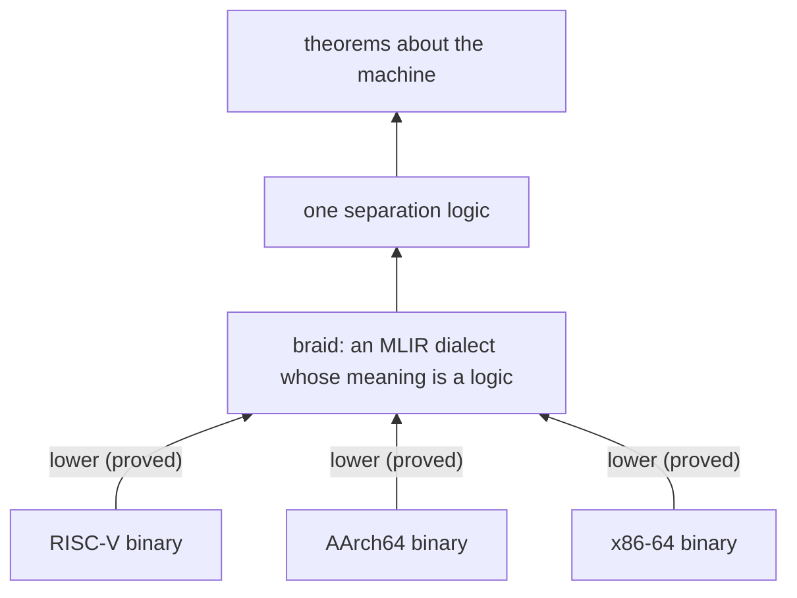

# Braid

Formally verify machine code in Lean, through one MLIR dialect for three instruction sets.

> [!WARNING]
> **Early days.** Braid is a young research project and it is changing quickly: the dialect,
> the logic, the interfaces and the file layout will all move as the design settles. Coverage
> of each instruction set is partial, and the models of the instruction sets are trusted, not
> verified. Read a result here as evidence, not yet as an audit: check exactly what each
> theorem states and assumes before relying on it ([`docs/Trust.md`](docs/Trust.md)).
> Questions, issues and feedback are very welcome.
>
> **Want to contribute?** Please read [`CONTRIBUTING.md`](CONTRIBUTING.md) first, and get in
> touch before starting work.

Braid takes the binary a compiler produced, not its source, and proves in Lean what it does.
RISC-V, AArch64 and x86-64 code is *lowered* into the same intermediate representation, an
[MLIR](https://mlir.llvm.org/) dialect called `braid`, and one separation logic over that
dialect does the proving. Each lowering is itself proved sound against a model of its
instruction set, so a theorem about the lowered code is a theorem about the machine. The
compiler, the linker and the decompiler are not trusted.

## The idea



1. **Lower.** `braid-lower` reads a binary and turns each instruction into a block of the
   `braid` dialect: word arithmetic, and explicit reads and writes of registers, flags and
   memory. It writes the result as MLIR text, for reading and for other tools, and as a Lean
   module, for proofs.
2. **A dialect whose meaning is a logic.** Each operation denotes a weakest-precondition
   predicate transformer in Lean. A fault is `False`, a value the instruction set leaves
   undefined is a universal quantifier, and the runs of a program are an inductive predicate.
3. **Lowerings proved sound.** For each instruction set there is a theorem: if the lowered
   code reaches a postcondition, the machine does. The machine models are riscv-zkvm (tied to
   the Sail RISC-V model), Google DeepMind's arm64-semantics, and Kraken.
4. **One separation logic.** Triples with the frame rule built in, symbolic execution that
   never has to decide whether two pointers alias, and rules for calls, loops and arrays. It
   is written once, above the dialect, and is an instance of Iris's logic interface.

What comes out is a theorem about the machine model alone. This one is about Euclid's
algorithm, written in Rust and compiled for RISC-V:

```lean
theorem gcd_correct (s : MachineState) (hcode : ∀ p ∈ gcd_code, s.code p.1 = some p.2)
    (hpc : s.pc = 0x10010#64) :
    ∃ n s', stepN n s = some s' ∧ s'.pc = s.getReg .x1 &&& ~~~1#64 ∧
      s'.getReg .x10 = BitVec.ofNat 64 (Nat.gcd (s.getReg .x10).toNat (s.getReg .x11).toNat)
```

[`docs/Walkthrough.md`](docs/Walkthrough.md) follows it from the Rust source to this
statement.

## Status

| | RISC-V | AArch64 | x86-64 |
| --- | --- | --- | --- |
| Model | riscv-zkvm `Rv64` | arm64-semantics | Kraken `X64` |
| Lowering proved sound | all of RV64IM in the model | the integer core, and a first set of SIMD | the integer core, and vector moves and packed addition |
| Share of a Go binary lowered | (Go emits compressed code) | 95% | 95% |
| Decompiler front end | ELF | ELF | ELF with `objdump`'s disassembly |
| Verified examples, each down to the machine | 17: C, Rust, Swift, Python | 23: C, Rust, Swift, Go, Python, JavaScript | 21: C, Rust, Swift, Go, Python, JavaScript |

[`docs/Roadmap.md`](docs/Roadmap.md) says what exists, what does not, and what is next.

## Repository map

```
braid/        the dialect and the logic, as a package of their own (braid/README.md)
  Braid/IR/     syntax, semantics, the functional reading, printers
  Braid/Logic/  heaps, assertions, triples, symbolic execution, tactics
Lowering/     the three lowerings and their soundness proofs (Lowering/README.md)
  RiscV/  Arm/  X86/
Tools/        braid-lower, the decompiler, and braid-difftest (Tools/README.md)
Examples/     sources, lowered images and proofs (Examples/README.md)
docs/         design notes
```

## Building

The Lean toolchain is pinned in `lean-toolchain` and installed by
[elan](https://github.com/leanprover/elan).

```sh
lake build                  # the lowerings, their proofs, and the tools
lake build Braid BraidTest  # the dialect and the logic alone
lake build Examples         # the example corpus
```

To check one file while working, use `lake env lean path/to/File.lean`.

## Using it

**The decompiler.** `lake build braid-lower` puts the program at
`.lake/build/bin/braid-lower`.

```sh
braid-lower prog.elf --list                       # the functions of a binary
braid-lower prog.elf --stats                      # how much of it the lowering covers
braid-lower prog.elf --fn gcd --mlir gcd.mlir     # MLIR text
braid-lower prog.elf --fn gcd --lean Gcd.lean --module Gcd   # a Lean module
braid-lower prog.elf --disasm prog.dis --fn gcd --lean Gcd.lean   # x86-64: with objdump -d
```

**The proof library.** A project that proves things about lowered code requires this
repository and imports the lowering of its instruction set, which brings the dialect and the
logic with it:

```toml
[[require]]
name = "machine-checked-mlir"
git = "https://github.com/dhsorens/braid"
```

```lean
import Lowering.RiscV.Logic   -- or Lowering.Arm.Logic, Lowering.X86.Logic
import Gcd                    -- the module braid-lower wrote
```

A project that wants the dialect and the logic alone, without any instruction-set model,
requires the `braid` package in the `braid/` subdirectory ([`braid/README.md`](braid/README.md)).

## Documentation

- [`docs/Walkthrough.md`](docs/Walkthrough.md): one function, from source to a theorem about
  the machine. Start here.
- [`braid/README.md`](braid/README.md): the dialect, its semantics, the logic and its tactics.
- [`docs/Architecture.md`](docs/Architecture.md): the design, and the theorems that hold it
  together.
- [`Lowering/README.md`](Lowering/README.md): the three lowerings, what each covers, and what
  each proves.
- [`Tools/README.md`](Tools/README.md): the decompiler and the differential tester.
- [`Examples/README.md`](Examples/README.md): the example corpus.
- [`docs/Trust.md`](docs/Trust.md): what is trusted and what is not.
- [`docs/ISA.md`](docs/ISA.md): the instruction-set models, and what we would like from them.
- [`docs/Leakage.md`](docs/Leakage.md): what a run reveals: the leakage model, traces, and
  what the model does not cover.
- [`docs/Programs.md`](docs/Programs.md): whole programs: a loaded binary, calls within
  it, and SHA-256 of a message proved from the entry point.
- [`docs/Continuity.md`](docs/Continuity.md): how much the lowered code changes when the
  source changes a little, and how much of a proof survives a recompile.
- [`docs/Scaling.md`](docs/Scaling.md): how proofs scale with the size of the code, measured.
- [`docs/RELATED.md`](docs/RELATED.md): related work.
- [`docs/Roadmap.md`](docs/Roadmap.md): where the code stands and what is next.

## Contributing

Contributions are welcome. While the project is young, please get in touch with the
maintainer, Derek Sorensen, before starting work, for example on the
[Lean Zulip](https://leanprover.zulipchat.com). Then see [`CONTRIBUTING.md`](CONTRIBUTING.md)
and [`STYLE.md`](STYLE.md).

## Licence

Apache-2.0 ([`LICENSE`](LICENSE)). The instruction-set models and iris-lean are dependencies
under their own licences.

## Acknowledgements

Braid builds on [machine-checked](https://github.com/Verified-zkEVM/machine-checked/).
