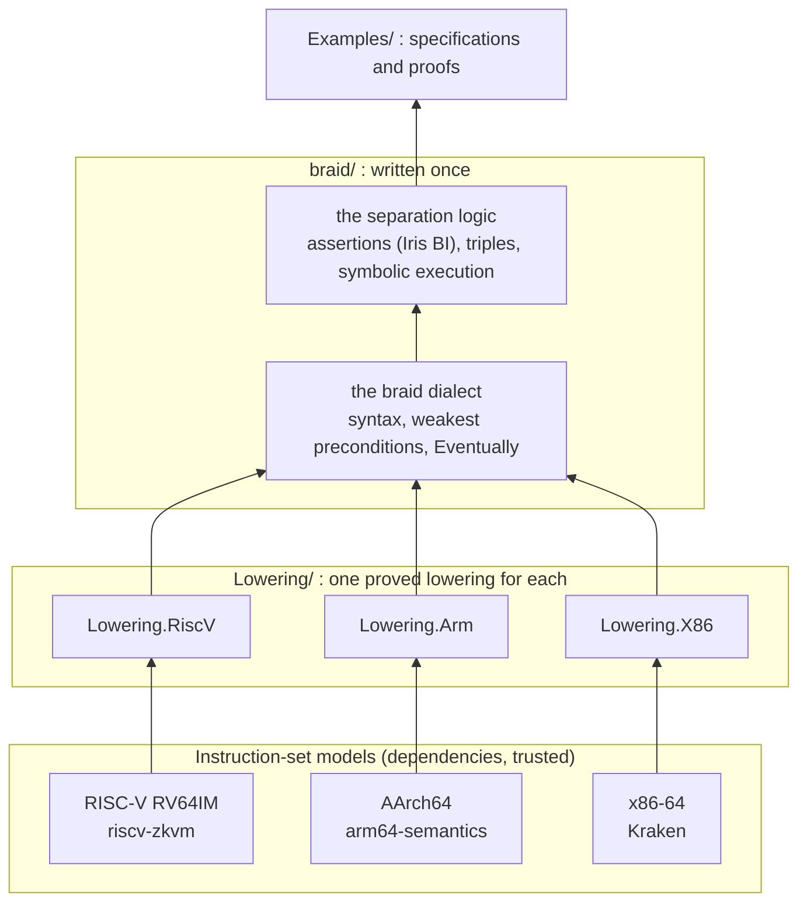
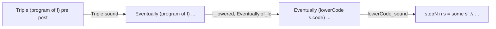

# Architecture

Braid verifies machine code in Lean. A binary for any of three instruction sets is lowered
into one MLIR dialect, `braid`, and one separation logic over that dialect is used to prove
what the code does. Each lowering is proved sound against a model of its instruction set, so a
theorem about the lowered code is a theorem about the machine.



## The pieces

| Directory | What it is | Depends on |
| --- | --- | --- |
| [`braid/`](../braid/README.md) | the dialect, its semantics, the logic | iris-lean |
| [`Lowering/`](../Lowering/README.md) | the three lowerings and their soundness proofs | `braid`, the three models |
| [`Tools/`](../Tools/README.md) | `braid-lower`, the decompiler, and `braid-difftest` | `Lowering` |
| [`Examples/`](../Examples/README.md) | sources, lowered images, proofs | `Lowering` |

## The dialect is first-order; the logic is in Lean

The dialect has no quantifiers, no assertions and no types beyond the 64-bit word. An
operation is word arithmetic, or a read or write of a register, a flag or memory. This keeps
the lowerings simple, since a block is what its instruction does and no more, and it keeps
the dialect open to more than one logic.

Higher-order logic enters with the meaning. Each operation denotes a predicate transformer:
`op.wp ρ σ Q` is the weakest precondition under which `op` runs without fault from `ρ` and
`σ` and establishes `Q`. Three things an instruction set does that a function cannot express
all fit this form:

- a **fault** is `False`;
- an **undefined value**, such as a flag x86 leaves undefined, is a universal quantifier
  (`havoc`);
- a **condition for being defined at all**, such as an aligned stack pointer, is a conjunct
  (`guard`).

A program's runs are captured by `Eventually P Q σ`, the least predicate closed under "`Q`
holds now, or a step is defined and every outcome is in the predicate again". This is the
omni-semantics style, and it is the form x86-64's model, Kraken, takes too.

## What a lowering proves

For an instruction set with states `S` and a step, a lowering gives:

1. `lower : Word → Instr → Block`, the block of one instruction at an address;
2. `Rel : S → State → Prop`, saying a machine state and a `braid` state describe the same
   machine;
3. a theorem for one instruction: if the states are related and the block's weakest
   precondition for `Q` holds, the machine takes its step to a state related to one
   satisfying `Q`;
4. a theorem for programs: `Eventually` for the lowered code gives a run of the machine.

The direction matters. The proof goes from the lowered code to the machine: whatever is proved
of the `braid` program holds of the binary. The lowered code may fault where the machine would
not, and an instruction the lowering does not cover is a `trap`. Both make proofs harder to
finish and never make them wrong.

One block for each instruction keeps the simulation exact: one step of the `braid` program is
one step of the machine. Passes that merge blocks or remove dead operations come later, each
with its own proof that it preserves `Eventually`.

## The logic

Assertions are predicates on heaps, where a heap holds the values of some registers, flags,
bytes and the program counter. They form an Iris `BI`, so entailments can be proved with the
Iris proof mode.

The triple puts the frame inside:

```lean
def Triple (P : Program) (pre post : SProp) : Prop :=
  ∀ R σ, (pre ∗ R) σ.heap → Eventually P (fun σ' => (post ∗ R) σ'.heap) σ
```

This is the shape of Myreen's machine-code Hoare triples and of Jensen, Benton and Kennedy's
logic for x86: the program counter is in the assertions, and the frame rule is a consequence
of the definition and not a property to prove of each instruction.

Symbolic execution keeps the state as a list of points-to atoms. A rule for an operation finds
the atom it reads or replaces the atom it writes:

```lean
theorem OpsSpec.load' (ha : ρ a = addr) (hat : as.At (.mem addr n v w)) (hn : n = W.bytes)
    (h : OpsSpec ops (ρ.set d ((v.truncate W.bits).zeroExtend 64)) as Φ) :
    OpsSpec (.load d W a :: ops) ρ as Φ
```

The atom is found by its address, syntactically. Whether two addresses might be equal is never
asked: two atoms of one list are disjoint because the list is a separating conjunction.

## From a triple to the machine



`machine_sound` is this chain. Its hypotheses are that the machine holds the instructions of
the function and that its state satisfies the atoms of the precondition. Its conclusion is a
run of the machine, and the postcondition is read off the final state with
`Atoms.reg_of_holds` and its companions.

## Design decisions, and what they cost

**State in operations, not in SSA values.** Registers and memory are read and written by
`get`, `set`, `load` and `store`, and SSA values live for one block. A lowering is then a
direct transcription, and a block is small. The cost is that the dialect in this form is
further from what an optimising pass wants. Promoting registers to SSA values across blocks is
a pass to add, with a proof.

**One word type.** Every value is 64 bits. A 32-bit operation is a 64-bit one followed by an
extension. The semantics has no ill-typed case, and `bv_decide` sees one width. The cost is
that vectors do not fit: SIMD is planned as lanes of words ([`Roadmap.md`](Roadmap.md)).

**Partial memory with a writable bit.** A byte is mapped or not, and writable or not. This is
the least that all three models need: Kraken's memory is a partial map, arm64-semantics has
permissions, and riscv-zkvm has valid ranges. It is also exactly a heap, which is what makes
the points-to rules short.

**Soundness proved, completeness tested.** Proving that the lowered code runs wherever the
machine does would double the work of each lowering, and no theorem about a binary needs it.
`braid-difftest` checks it on runs instead.

**Lists of atoms for symbolic states.** A list keeps its order, so most proofs end by `rfl`,
and finding an atom is a syntactic match. The cost is that an assertion with structure, such
as an array, has to be opened and closed by hand (`braid_unfold`, `braid_fold`).
