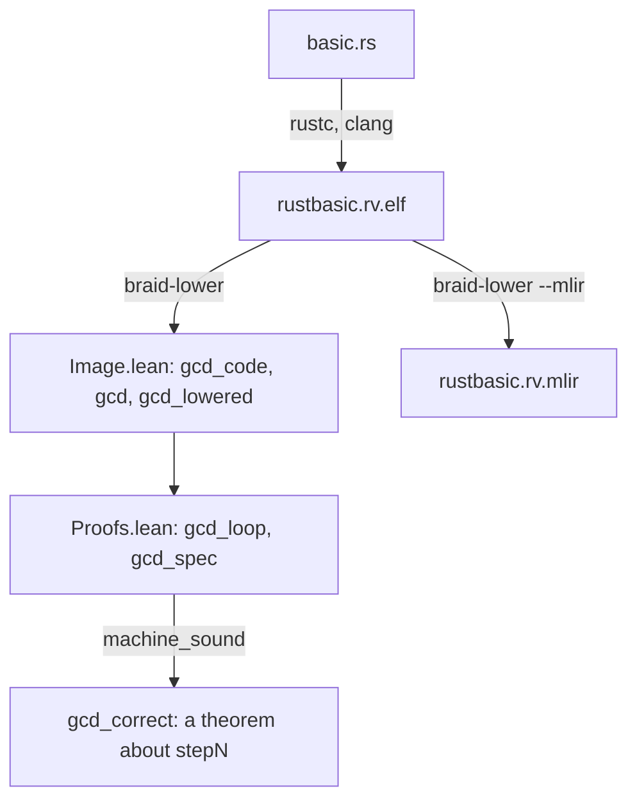

# Walkthrough: one function, from source to a theorem about the machine

This follows Euclid's algorithm, written in Rust, through every stage: compiling, lowering,
specifying, proving, and stating the result about the RISC-V machine. The files are
`Examples/src/rust/basic.rs` and `Examples/RustBasic/RiscV/`.



## 1. The source

```rust
#[no_mangle]
pub extern "C" fn gcd(mut a: u64, mut b: u64) -> u64 {
    while b != 0 {
        let t = a % b;
        a = b;
        b = t;
    }
    a
}
```

## 2. Compile

`Examples/build.sh rustbasic` compiles the source and links it at `0x10000`. Rust goes through
LLVM IR, so that one back end produces the code for every instruction set. The six
instructions of `gcd`:

```
0000000000010010 <gcd>:
   10010:  beqz  a1, 0x10024
   10014:  remu  a2, a0, a1
   10018:  mv    a0, a1
   1001c:  mv    a1, a2
   10020:  bnez  a2, 0x10014
   10024:  ret
```

## 3. Lower

The same script runs the decompiler:

```sh
braid-lower Examples/bin/rustbasic.rv.elf --fn gcd \
  --mlir Examples/mlir/rustbasic.rv.mlir \
  --lean Examples/RustBasic/RiscV/Image.lean --module Examples.RustBasic.RiscV
```

It writes three things into `Image.lean`. The instructions, as the machine model has them
(names are shortened here):

```lean
def gcd_code : List (BitVec 64 × Instr) := [
  (0x10010#64, Instr.BEQ Reg.x11 Reg.x0 0x0014#13),
  (0x10014#64, Instr.REMU Reg.x12 Reg.x10 Reg.x11),
  ...]
```

The lowered function, one block for each instruction:

```lean
def gcd : Braid.Func :=
  { name := "gcd", entry := 0x10010#64, blocks := [
    (0x10010#64, { ops := [.get 0 11, .const 1 0x0#64, .bin 2 .eq 0 1],
                   term := .branch 2 0x10024#64 0x10014#64 }),
    (0x10014#64, { ops := [.get 0 10, .get 1 11, .bin 2 .urem 0 1, .const 3 0x0#64,
                           .bin 4 .eq 1 3, .select 6 4 0 2, .set 12 6],
                   term := .jump 0x10018#64 }),
    ...] }
```

And a certificate that the second is the lowering of the first, which the kernel checks:

```lean
theorem gcd_lowered :
    gcd.blocks = gcd_code.map fun p => (p.1, Lowering.RiscV.lower p.1 p.2) := by
  decide
```

The decompiler is not trusted. If it wrote the wrong blocks, `gcd_lowered` would not check.

Look at the block of `remu`. RISC-V defines a remainder by zero to be the dividend, and the
dialect's `urem` agrees, but the lowering does not rely on that: it selects the dividend
explicitly when the divisor is zero. The block says what the instruction does, operation by
operation.

## 4. Specify

The specification is a triple. Its precondition says where execution starts and what the
registers hold; its postcondition says where execution has got to and what they hold then.

```lean
def wgcd (a b : Word) : Word := BitVec.ofNat 64 (Nat.gcd a.toNat b.toNat)

theorem gcd_spec (a b t r : Word) :
    Triple gcd.program
      (Atoms.interp [.pc 0x10010#64, .reg a0 a, .reg a1 b, .reg a2 t, .reg ra r])
      (Atoms.interp [.pc (r &&& ~~~1#64), .reg a0 (wgcd a b), .prop (regAny a1),
        .prop (regAny a2), .reg ra r])
```

Read it as: from the entry of `gcd`, with `a` and `b` in the argument registers and `r` in the
return-address register, every run reaches the return address with `gcd a b` in `a0`. The
registers `a1` and `a2` hold something. The return address is `r` with its low bit cleared,
which is what `jalr` does.

The triple mentions the five locations the code touches and no others. The frame rule adds any
others: `(gcd_spec a b t r).frame F` holds for every assertion `F`.

## 5. Prove

The loop first. Its measure is the divisor, so the proof is by strong induction on it:

```lean
theorem gcd_loop (r : Word) (k : Nat) : ∀ a b t : Word, b.toNat = k → b ≠ 0#64 →
    Triple gcd.program
      (Atoms.interp [.pc 0x10014#64, .reg a0 a, .reg a1 b, .reg a2 t, .reg ra r])
      (Atoms.interp [.pc (r &&& ~~~1#64), .reg a0 (wgcd a b), .reg a1 0#64, .reg a2 0#64,
        .reg ra r]) := by
  induction k using Nat.strongRecOn with
  | ind k ih =>
    intro a b t hk hb
    iterate 3 braid_step      -- remu, mv, mv
    braid_step                -- bnez: two goals
    · simp only [hb, ↓reduceIte] at hbr ⊢
      refine (ih _ ?_ b (a % b) _ rfl hbr).cast rfl (by simp [wgcd_rec a b])
      rw [← hk, BitVec.toNat_umod]
      exact Nat.mod_lt _ (Nat.pos_of_ne_zero fun h => hb (BitVec.eq_of_toNat_eq h))
    · simp only [hb, ↓reduceIte] at hbr ⊢
      braid_run
      exact Triple.done_eq (by simp [wgcd_rec a b, hbr, wgcd_zero])
```

`braid_step` runs one block on the symbolic state. After three steps the state is

```
[.pc 0x10020, .reg a0 b, .reg a1 (a % b), .reg a2 (a % b), .reg ra r]
```

and the fourth step, the conditional branch, leaves two goals with the condition as `hbr`. In
the first the remainder is not zero and execution is back at the head of the loop with a
smaller divisor, so the induction hypothesis applies. In the second the remainder is zero,
`braid_run` runs the return, and what is left is arithmetic: `gcd a b = b` when `b` divides
`a`.

The function is then a branch and a use of the loop:

```lean
theorem gcd_spec ... := by
  braid_step
  · subst hbr                       -- b = 0: return a
    braid_run
    braid_forget 11
    braid_forget 12
    exact Triple.done_eq (by simp [wgcd_zero])
  · braid_call gcd_loop r _ a b t rfl hbr
    braid_forget 11
    braid_forget 12
    braid_done
```

`braid_call` takes the precondition of `gcd_loop` out of the symbolic state and puts its
postcondition back. It is the same tactic that handles a function call: a call is a jump to
code with a specification.

## 6. Down to the machine

`machine_sound` composes three things: `gcd_lowered`, the soundness of the RISC-V lowering,
and the triple. What comes out has no notion of the dialect or the logic in its statement:

```lean
theorem gcd_correct (s : MachineState) (hcode : ∀ p ∈ gcd_code, s.code p.1 = some p.2)
    (hpc : s.pc = 0x10010#64) :
    ∃ n s', stepN n s = some s' ∧ s'.pc = s.getReg .x1 &&& ~~~1#64 ∧
      s'.getReg .x10 = BitVec.ofNat 64 (Nat.gcd (s.getReg .x10).toNat (s.getReg .x11).toNat)
```

A RISC-V machine that holds the six instructions of `gcd` and is at its entry runs, in some
number of steps and without a trap, to the return address with the greatest common divisor of
`a0` and `a1` in `a0`. `stepN` and `MachineState` are riscv-zkvm's.

`#print axioms gcd_correct` lists `propext`, `Classical.choice`, `Quot.sound` and the axioms of
the `bv_decide` calls in the memory lemmas of the lowering ([`Trust.md`](Trust.md)).

## 7. Test

The lowering is proved sound: if the lowered code runs, the machine runs the same way. The
other direction is tested. `braid-difftest` runs the machine model and the lowered code side
by side and compares every register after every instruction:

```sh
$ braid-difftest Examples/bin/rustbasic.rv.elf --fn gcd --args 48,18
gcd: agree after 14 instructions, a0 = 0x6
$ braid-difftest Examples/bin/rustbasic.rv.elf --fn gcd --runs 200 --seed 3
gcd: 200/200 runs agree
```
